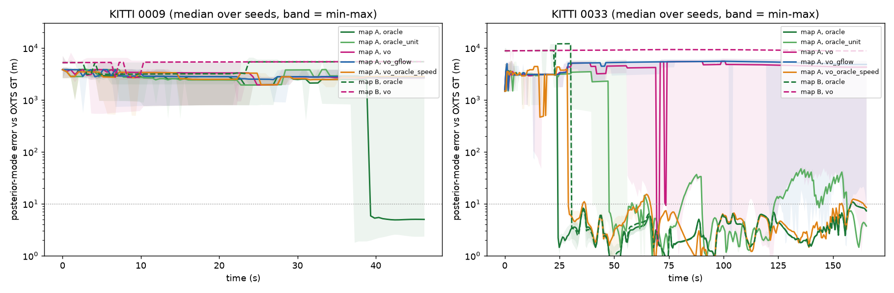

# Road-graph particle filter on KITTI: what it needs and what it does here

`monocular_osm/graph_filter.py` is a sequential Monte Carlo localiser on the
directed OSM road graph, in the style of Brubaker, Geiger & Urtasun
([CVPR 2013](https://openaccess.thecvf.com/content_cvpr_2013/html/Brubaker_Lost_Leveraging_the_2013_CVPR_paper.html)):
odometry plus a road map, no GPS, no appearance. It is available as the opt-in
`--graph-filter` channel. This page records its evaluation on the two KITTI
drives in the benchmark. The historical research evaluator is
`python scripts/eval_graph_filter.py` (hours of CPU; results land in
`output/graph_filter/`). It reads raw camera PNGs, KITTI rectified camera
calibration and OXTS sensor timestamps. Its five-seed results describe that
input regime. A separate MP4-only test is recorded immediately below.

## Strict MP4-only check (2026-10-27)

`scripts/probe_strict_video_filter.py` ran fresh inference from the registered
whole MP4 window and the cached whole-city Karlsruhe road graph. Inference
used 1,594 native 1226×370 video frames at stride 1, generic 70° horizontal-FOV
intrinsics (`fx=fy=875.4547`), road-plane camera height 1.5 m and rotation-based
VO heading. Timing came entirely from MP4 presentation times and its encoded
10 FPS timebase: the requested full window was 0:165 s and decoded video times
were 0.0–159.3 s. The process read no calibration, raw PNGs, GPS/OXTS fixes or
sensor timestamp files. No position prior, VPR observations or network access
were used.

The city-wide filter used 600,000 particles, seed 0 and 319 steps at about 2 Hz.
Road-plane coverage was 51.83%; the estimator's own spread set the metric-speed
deviation sigma to 0.09738, with metric log-scale prior sigma 0.25. The frame
cache was bounded to 128 MB and genealogy storage to 256 MB. Genealogy thinning
changes smoothed-route interpolation, while particle modes and random draws
remain unchanged. CPU inference took 439.9 s, with sampled peak private memory
1,093 MB and RSS 674 MB.

Prediction, configuration, source snapshots, video hash and map hash were frozen
before a separate scoring process opened labels. Scoring aligned synced OXTS
positions by rendered-frame index; it read no sensor timestamp files.

| Seed 0 metric | Result |
|---|---:|
| Time to localize (video time) | 78.5 s |
| Mean posterior-mode error after localization | 5.48 m |
| Final posterior-mode error | 13.30 m |
| Mean posterior-mode error over the whole drive | 4,695.75 m |
| Smoothed per-frame mean error | 8.71 m |
| Smoothed route GT→prediction mean, committed waypoints | 2.80 m |
| Smoothed route symmetric mean, committed waypoints | 4.83 m |
| Smoothed route endpoint error | 3.77 m |

The accurate smoothed route is an offline result; the early city-wide modes
are wrong. The seed-0 prediction and score above remain preserved separately.

Four subsequent, predeclared seeds (1–4) reused the exact frozen MP4-derived VO,
road-plane and odometry artifacts. Every original artifact, source snapshot,
video and map hash was verified; the particle-filter seed was the only changed
filter setting. All four predictions and their input/source hashes were frozen
as a batch before a separate process scored them. Every seed was retained.

| PF seed | Time to localize (s) | Final mode error (m) | Whole-run online mean error (m) | Smoothed route symmetric mean (m) |
|---|---:|---:|---:|---:|
| 0 | 78.5 | 13.30 | 4,695.75 | 4.83 |
| 1 | 78.5 | 13.41 | 3,477.24 | 5.32 |
| 2 | 76.5 | 13.29 | 3,726.42 | 5.09 |
| 3 | 79.0 | 13.26 | 4,998.65 | 4.67 |
| 4 | 79.5 | 13.61 | 4,891.47 | 5.18 |

All five PF seeds localized. Across seeds, mean ± population standard deviation:
time to localize **78.4 ± 1.02 s**; subsequent mean mode error **5.35 ± 0.17 m**;
final mode error **13.38 ± 0.13 m**; smoothed per-frame mean error
**9.22 ± 1.10 m**; smoothed waypoint-route symmetric error **5.02 ± 0.24 m**.
Whole-run online mean error was **4,357.91 ± 629.88 m**. The four sequential
replications took 462.6 s total, with native Windows peak private commit
689.5 MB and working set 664.2 MB.

This establishes particle-filter seed robustness on one video's fixed visual
odometry. It leaves independent-video, independent-VO and default-pipeline
sampling/200,000-particle validation outstanding. Posterior mass remains
uncalibrated.

Reproduce inference first, then run scoring separately:

```bash
python scripts/probe_strict_video_filter.py --video data/kitti/drive_0033.mp4 --city "Karlsruhe, Germany" --graph output/graph_filter/graph_B_karlsruhe_city.graphml --start 0 --end 165 --particles 600000 --seed 0 --threads 2 --frame-memory-mb 128 --path-budget-mb 256 --output output/strict_video_filter/kitti0033_seed0
```

Local evidence is under `output/strict_video_filter/kitti0033_seed0/`:
`frozen_prediction.json`, `offline_score.json` and `source_snapshot/`.
Frozen manifest SHA256:
`d4a6b085f1f62207cc81dc68a0446a3f0c4e969c2905c852aeecb761f474c4ec`.
The command refuses to reuse a nonempty output directory; choose a fresh one
for another run. Source snapshots preserve the exact code loaded for this run.

Replicate the frozen inputs, then score the complete batch in a separate process:

```bash
python scripts/replicate_strict_video_filter.py --base output/strict_video_filter/kitti0033_seed0 --seeds 1 2 3 4 --threads 2 --output output/strict_video_filter/kitti0033_seeds1_4
python scripts/score_frozen_video_filter.py --batch output/strict_video_filter/kitti0033_seeds1_4 --labels-dir data/kitti/raw/2011_09_30/2011_09_30_drive_0033_sync/oxts/data --waypoints ground_truth/kitti_drive_0033.json
```

The scorer verifies a complete batch freeze before accessing labels. It uses
rendered-frame indices for position labels and video time for latency; sensor
timestamp files remain unused. Evidence is in
`output/strict_video_filter/kitti0033_seeds1_4/frozen_predictions.json` and
`offline_score_all_seeds.json`. Batch manifest SHA256:
`6bc58af8b365ae09a8b14e8fb5753655aee5386189b1736bb6ce4cd9f37ecf32`.

## Normal pipeline filter-only entry point

`--answer filter` (alias `--graph-filter-only`) skips retrieval and matching.
Its defaults are 600,000 particles, seed 0, generic 70° intrinsics, road-plane
height 1.5 m, two VO workers, a 256 MiB genealogy budget and video sampling near
10 Hz when `--frame-stride` is omitted. The independent named-city map uses
its own cache. `--graph-filter-map-path` supplies an existing whole-city driving
GraphML; its scope is a trusted database declaration, while the SHA binds its
actual bytes. Its configured path remains visible in override audits.

The profile uses actual video intervals and absolute video route times. It
rejects position discs, labels, VPR observations and a route-length prior.
Source bytes, video/map hashes, full PF arrays, selected answer and map are
checkpointed before separate evaluation. Existing default behavior is retained.

```bash
python main.py --video data/kitti/drive_0033.mp4 --city "Karlsruhe, Germany" --answer filter --vo-segment 0:165 --frame-memory-mb 128 --vo-workers 2 --graph-filter-map-path output/graph_filter/graph_B_karlsruhe_city.graphml --graph-filter-seed 0 --data-dir data/strict_pipeline_pf --output-dir output/strict_pipeline_pf
python scripts/score_filter_checkpoint.py --checkpoint output/strict_pipeline_pf/local-7bb2db3254be-drive-0033-karlsruhe-germany --labels-dir data/kitti/raw/2011_09_30/2011_09_30_drive_0033_sync/oxts/data --waypoints ground_truth/kitti_drive_0033.json
```

This normal-entrypoint run computed fresh VO and reproduced the standalone
seed-0 trajectory, posterior modes, smoothed route and particle weights
bit-for-bit. Selected-answer symmetric error was 4.83 m and endpoint error
3.74 m after coordinate rounding; PF online metrics were identical to seed 0
above. The console, map links and `answer.png` all displayed the selected route.
Native peak private commit was 1,432 MB and working set 1,021 MB. The public
256 MiB setting converts to 268.435456 decimal MB internally; both budgets use
genealogy stride 12 here, preserving the exact route. Frozen manifest SHA256:
`15da5a787ab0d1994256ebdcca6035616621399ecdcd4f1e84fd440aee11f671`.

A second normal benchmark run at clean commit `f9ad7d23` tested automatic
named-city map loading on KITTI 0033. Its inputs were a separate copy of the
registered MP4 and public cached OSM HTTP responses. `--graph-filter-only`
resolved the city map automatically; the recorded configured map path, position
disc and bounding box were all null. The city query was `Karlsruhe, Germany`.
The selected answer scored **4.80 m symmetric route error**, and inference took
405.8 s. The strict filter input audit passed on this real result. The full
development-goal audit correctly rejected this one-clip run as incomplete.

The run is named `filter_city_auto`, with a complete prediction/source freeze
before offline aggregation. Its constructed city-map SHA256 is
`e27cb1fd5b2f399392dc7a8c868b1e4f37630e3991473a4d2504de4a1f2e4437`.
This adds an automatic-map check on the same video; the five-seed and broader
generalization limitations above still apply.

## Historical calibrated-camera and sensor-time summary

* **With real odometry it works, even on a whole city.** KITTI 0033 (165 s,
  Karlsruhe) with the OXTS speed and heading localizes all 5 seeds in about 25 s
  to 7 m on a 35 km² box, and in about 31 s to 7 m on the *entire* Karlsruhe
  road network (1,605 directed km, 600,000 particles). That matches the
  published result for this problem (about 3-4 m after 20-52 s on a comparable
  map).
* **Speed is the missing signal, not heading.** With the *true* heading but a
  constant step length (what this repo's visual odometry provides) it localizes
  only at the very end of the drive (157 s); with VO headings and the true speed
  it localizes in 29 s.
* **This repo's monocular VO does not suffice.** Every VO step is normalised to
  unit length, so there is no speed, and the yaw drifts 8-14 degrees per minute.
  The filter localized on 2 of 5 seeds on the box and 0 of 5 on the city, and the
  failures are *deterministic wrong attractors* (the same 4.3, 5.7 and 8.8 km
  errors repeat across seeds). The ground-flow speed profile correlates only
  0.44-0.60 with true step length and did not rescue it (1 of 5).
* **Road-plane speed closes most of the gap in the research setup** (added
  2026-10-16, [below](#road-plane-speed)). Giving each VO step a metric length
  from the road plane and an assumed camera height localizes 0033 on the
  whole Karlsruhe map in 5 of 5 seeds (final ~10 m, smoothed route within
  1 m), with calibrated intrinsics and sensor timing, no GPS position
  observations and no image retrieval. Success came near the end of the
  drive, with sensitivity to assumed height; 0009 still failed.
* **Its confidence is not calibrated for this input.** Only 3 of 14 monocular-VO
  runs reporting confidence above 0.8 were right. Do not present it as a
  probability of correctness.
* **The short drive (0009, 46 s, one turn) is too short** even with perfect
  odometry: it localizes (4 of 5) only on the box, with 0.07-0.10 posterior mass,
  and never on the city.

These ablations show the value of metric steps for this map-matching core.
Other trajectory sources with metric steps (VGGT-Long, Depth Anything 3,
MapAnything) were not evaluated here.

## Setup

Map A is a fixed 35 km² box around the recording area (the same box for both
drives, a Brubaker-style assumption that is **not deployable**); map B is the
full Karlsruhe drive network (a named-city spatial prior). "Localized" means
the mode error first falls under 10 m and stays under 20 m afterwards. Oracle
variants use OXTS speed/heading; VO variants use calibrated camera PNGs and
OXTS timestamp differences. GPS positions enter scoring and diagnostics, rather
than position observations. The road-plane scale-prior choice following bias
diagnostics is described below. Numbers are mean ± std over 5 seeds at a 2 Hz
filter rate.



Generated by `scripts/eval_graph_filter.py` at commit `be2afd0`; 5 seeds per row, mean ± std over seeds. Filter at 2 Hz. Map A = fixed box (8.425, 48.958, 8.495, 49.02) (W,S,E,N), same for both drives; map B = Karlsruhe city (osmnx drive network).

| Drive | Map | Odometry | N | Localized seeds | Time to localize (s) | Final err (m) | Mean err (m) | Steps < 10 m | Mass ≤ 25 m of GT at end | Smoothed route err (m) | README-style route err (m) | Runtime (s) |
|---|---|---|---|---|---|---|---|---|---|---|---|---|
| 0009 | A | oracle | 300,000 | 4/5 | 38.6 ± 1.1 | 787 ± 1566 | 2177 ± 519 | 15 ± 8 % | 0.08 ± 0.01 | 762 ± 1502 | 737 ± 1470 | 18 ± 0 |
| 0009 | A | oracle_unit | 300,000 | 0/5 | — | 3140 ± 603 | 2835 ± 133 | 0 ± 0 % | 0.01 ± 0.00 | 3197 ± 511 | 3143 ± 534 | 18 ± 0 |
| 0009 | A | vo_oracle_speed | 300,000 | 0/5 | — | 2740 ± 112 | 2728 ± 267 | 0 ± 0 % | 0.03 ± 0.01 | 2781 ± 139 | 2687 ± 161 | 19 ± 0 |
| 0009 | A | vo | 300,000 | 0/5 | — | 2896 ± 507 | 3019 ± 225 | 0 ± 0 % | 0.00 ± 0.00 | 2921 ± 474 | 2896 ± 484 | 18 ± 0 |
| 0009 | A | vo_gflow | 300,000 | 0/5 | — | 2723 ± 119 | 2769 ± 391 | 0 ± 0 % | 0.01 ± 0.00 | 2774 ± 131 | 2747 ± 123 | 17 ± 0 |
| 0009 | B | oracle | 600,000 | 0/5 | — | 5430 ± 1 | 4422 ± 748 | 0 ± 0 % | 0.01 ± 0.00 | 5360 ± 13 | 5302 ± 46 | 44 ± 1 |
| 0009 | B | vo | 600,000 | 0/5 | — | 5444 ± 10 | 4890 ± 571 | 0 ± 0 % | 0.00 ± 0.00 | 5372 ± 8 | 5348 ± 35 | 49 ± 13 |
| 0033 | A | oracle | 300,000 | 5/5 | 24.6 ± 0.3 | 7 ± 0 | 462 ± 16 | 84 ± 0 % | 1.00 ± 0.00 | 5 ± 1 | 1 ± 0 | 79 ± 17 |
| 0033 | A | oracle_unit | 300,000 | 5/5 | 156.7 ± 0.0 | 4 ± 0 | 920 ± 321 | 45 ± 3 % | 0.96 ± 0.00 | 7 ± 1 | 1 ± 0 | 96 ± 34 |
| 0033 | A | vo_oracle_speed | 300,000 | 5/5 | 29.3 ± 0.3 | 8 ± 0 | 562 ± 25 | 75 ± 1 % | 1.00 ± 0.00 | 5 ± 1 | 1 ± 0 | 149 ± 47 |
| 0033 | A | vo | 300,000 | 2/5 | 155.7 ± 1.0 | 3123 ± 2596 | 3400 ± 1285 | 14 ± 12 % | 0.37 ± 0.44 | 3284 ± 2720 | 3259 ± 2710 | 201 ± 60 |
| 0033 | A | vo_gflow | 300,000 | 1/5 | 165.3 ± 0.0 | 4086 ± 2105 | 4576 ± 522 | 4 ± 7 % | 0.18 ± 0.36 | 4321 ± 2219 | 4280 ± 2207 | 93 ± 5 |
| 0033 | B | oracle | 600,000 | 5/5 | 30.6 ± 0.3 | 7 ± 0 | 1742 ± 98 | 81 ± 0 % | 1.00 ± 0.00 | 4 ± 1 | 1 ± 0 | 256 ± 2 |
| 0033 | B | vo | 600,000 | 0/5 | — | 8801 ± 1 | 9052 ± 9 | 0 ± 0 % | 0.00 ± 0.00 | 9056 ± 2 | 9038 ± 19 | 1938 ± 102 |

README-style route err = `monocular_osm.metrics.score_route(...).gt_to_pred_mean_m` of the smoothed route vs the committed GT waypoints (the benchmark's headline metric; one-directional, see metrics.py).

Existing pipeline on the same drives (README, GPS-free, mean route error): KITTI 0009 5,568 m, 0033 7,126 m; city-centroid baseline 2,645 m / 6,843 m.

## Monocular VO vs OXTS

```json
{
 "0009": {
  "frames": 447,
  "valid_pair_frac": 0.8430493273542601,
  "moving_frac_oxts": 0.9013452914798207,
  "vo_zero_step_while_moving_frac": 0.05829596412556054,
  "heading_rotation": {
   "abs_err_deg_median": 1.9495443000512354,
   "abs_err_deg_p90": 5.441106158046802,
   "drift_deg_per_min": -8.276183267028339,
   "step_noise_deg": 0.45789117881508296,
   "mirror_check_corr": 0.996532652381788
  },
  "heading_translation": {
   "abs_err_deg_median": 5.235779607771247,
   "abs_err_deg_p90": 21.713845360951684,
   "drift_deg_per_min": -100.1349210399174,
   "step_noise_deg": 24.660278101634294,
   "mirror_check_corr": 0.3753550965508598
  },
  "distance_m": 331.30538003085826,
  "ground_flow": {
   "confidence": 1.0,
   "scale_median": 0.45659360155544926,
   "rel_err_after_global_scale_median": 0.3398133821014681,
   "corr_with_true_step": 0.5987463088401531
  }
 },
 "0033": {
  "frames": 1594,
  "valid_pair_frac": 0.9968612680477087,
  "moving_frac_oxts": 1.0,
  "vo_zero_step_while_moving_frac": 0.003138731952291274,
  "heading_rotation": {
   "abs_err_deg_median": 12.205330587753158,
   "abs_err_deg_p90": 27.344149865740018,
   "drift_deg_per_min": 14.080114267212535,
   "step_noise_deg": 0.9010844410399543,
   "mirror_check_corr": 0.992060397046046
  },
  "heading_translation": {
   "abs_err_deg_median": 13.306016815874038,
   "abs_err_deg_p90": 29.963794721594414,
   "drift_deg_per_min": 14.319799618368783,
   "step_noise_deg": 22.482988595256202,
   "mirror_check_corr": 0.9788545427219585
  },
  "distance_m": 1705.9650788914014,
  "ground_flow": {
   "confidence": 1.0,
   "scale_median": 0.5588969187373818,
   "rel_err_after_global_scale_median": 0.2888587930479804,
   "corr_with_true_step": 0.4408717579000626
  }
 }
}
```

## Ground truth vs map coverage (max distance GT -> nearest road)

```json
{
 "0009|A": {
  "max_m": 3.1887144269668366,
  "median_m": 1.775673356040382
 },
 "0009|B": {
  "max_m": 3.1887144269668366,
  "median_m": 1.775673356040382
 },
 "0033|A": {
  "max_m": 4.9299980732107365,
  "median_m": 1.6866474001975722
 },
 "0033|B": {
  "max_m": 4.929998073208023,
  "median_m": 1.6866474001953737
 }
}
```

## Road-plane speed

`monocular_osm/plane_speed.py` gives each VO step a metric length. For road
points two views are related by the plane homography `R + t m^T` (`m = n/d`);
with the VO's rotation and unit translation, `m` is linear in the
correspondences, so RANSAC per frame pair (scikit-image) gives the camera's
height above the road in step units, and an **assumed** camera height
(1.5 m; KITTI's camera is at 1.65 m) turns that into metres (Kitt et al. 2010;
Song & Chandraker 2014). Corners and Lucas-Kanade tracking are OpenCV's. The
road region and RANSAC settings were fixed before any filter run (two
alternative road-region settings were tried on 0009's speed profile and
discarded in favour of the default); the filter's global-scale prior
(log-sigma 0.25) was widened after the 0.76-0.84 scale bias below had been
seen. Regenerate with

```bash
python scripts/eval_graph_filter.py --odometry vo_plane vo_plane_rel --odometry-B vo_plane vo_plane_rel --tag plane
python scripts/eval_graph_filter.py --drives 0033 --maps B --odometry vo_plane --odometry-B vo_plane --camera-height-m 1.2 --tag plane_B_h1.2
```

**The speed estimate against OXTS** (in brackets: the ground-flow estimator
above):

| Drive | Correlation with true step | Median relative error after one global scale | Scale at 1.5 m assumed | Scale at the true 1.65 m | Pairs measured |
|---|---|---|---|---|---|
| 0009 | 0.88 (0.60) | 11 % (34 %) | 0.69 | 0.76 | 57 % |
| 0033 | 0.81 (0.44) | 11 % (29 %) | 0.76 | 0.84 | 55 % |

**The filter with it** (5 seeds, calibrated images and sensor timing as above;
`vo_plane` = metric steps at the assumed height, `vo_plane_rel` = the same
profile with the global scale left unknown, as `vo_gflow`):

| Drive | Map | Odometry | Localized seeds | Time to localize (s) | Final err (m) | Mean err (m) | Steps < 10 m | Smoothed route err (m) | README-style route err (m) |
|---|---|---|---|---|---|---|---|---|---|
| 0033 | A | vo_plane | 5/5 | 155.1 ± 0.0 | 10 ± 0 | 657 ± 130 | 47 % | 7 ± 1 | 1 ± 0 |
| 0033 | A | vo_plane_rel | 4/5 | 155.3 ± 1.1 | 1138 ± 2264 | 2591 ± 1440 | 28 % | 1196 ± 2373 | 1183 ± 2364 |
| 0033 | B | vo_plane | **5/5** | 155.1 ± 0.0 | **11 ± 0** | 5706 ± 1168 | 26 % | 8 ± 2 | **1 ± 0** |
| 0033 | B | vo_plane_rel | 0/5 | — | 8801 ± 1 | 9050 ± 16 | 0 % | 9055 ± 2 | 9016 ± 41 |
| 0009 | A | vo_plane | 0/5 | — | 2607 ± 22 | 2727 ± 219 | 0 % | 2642 ± 9 | 2616 ± 19 |
| 0009 | A | vo_plane_rel | 0/5 | — | 2662 ± 133 | 2605 ± 530 | 0 % | 2682 ± 146 | 2644 ± 138 |

For comparison (top table): 0033 on map B with unit-step VO 0/5 (8,801 m),
with OXTS odometry 5/5 (7 m, localized at 31 s); the full pipeline on this
drive is 7,094 m off and the centre of "Karlsruhe, Germany" 6,709 m
(benchmark run v2).

**Camera-height sensitivity** (0033, map B, `vo_plane`, 5 seeds):

| Assumed height | Scale vs OXTS | Localized seeds | Final errors (m) |
|---|---|---|---|
| 1.2 m | 0.61 | 1/5 | 11, 8800, 8800, 8802, 11759 |
| 1.5 m (default) | 0.76 | 5/5 | 10, 10, 11, 11, 11 |
| 1.8 m | 0.91 | 4/5 | 10, 10, 10, 10, 8803 |

What this shows, and what it does not:

* **Speed was the missing signal in this research setup.** With the whole-city
  spatial prior, calibrated images, sensor timing and no GPS position
  observations or image retrieval, metric steps turn a deterministic 8.8 km
  failure into 5 of 5 localizations of the loop drive.
* **The absolute scale matters, not only the speed profile.** The same profile
  with an unknown scale fails on the city map (0/5), and an assumed height
  20 % too low fails (1/5). The estimator reads about 0.8x short even at the
  true height, so the default sits near the edge of what works.
* **It localizes late.** The filter locks on at ~155 s of a 159 s drive (29-31 s
  with INS speed); for most of the drive its online answer is wrong (mean
  error 5.7 km on map B). The smoothed route at the end is right. It is an
  offline answer for a whole clip, not online tracking.
* **Its confidence still cannot be trusted.** The failed 1.2 m runs ended with
  confidence 1.00 on answers 8.8-11.8 km off.
* **One successful research drive.** 0009 (46 s, one turn) fails with any
  odometry on the city map. The strict generic-intrinsics MP4 result above
  supplies five successful PF seeds on a fixed fresh VO estimate of 0033.
  Independent dashcam, rolling-shutter, shorter-window and independent-VO
  validation remain outstanding.

