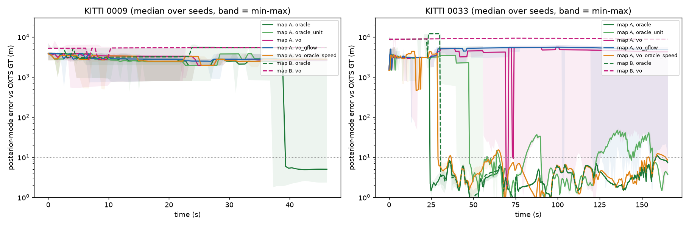

# Road-graph particle filter on KITTI: what it needs and what it does here

`monocular_osm/graph_filter.py` is a sequential Monte Carlo localiser on the
directed OSM road graph, in the style of Brubaker, Geiger & Urtasun
([CVPR 2013](https://openaccess.thecvf.com/content_cvpr_2013/html/Brubaker_Lost_Leveraging_the_2013_CVPR_paper.html)):
odometry plus a road map, no GPS, no appearance. It is available as the opt-in
`--graph-filter` channel. This page records its evaluation on the two KITTI
drives in the benchmark. Regenerate with `python scripts/eval_graph_filter.py`
(hours of CPU; results land in `output/graph_filter/`).

## Summary

* **With real odometry it works, even on a whole city.** KITTI 0033 (165 s,
  Karlsruhe) with the OXTS speed and heading localizes all 5 seeds in about 25 s
  to 7 m on an 18 km² box, and in about 31 s to 7 m on the *entire* Karlsruhe
  road network (1,605 directed km, 600,000 particles). That matches the
  published result for this problem (about 3-4 m after 20-52 s on a comparable
  map).
* **Speed is the missing signal, not heading.** With the *true* heading but a
  constant step length (what this repo's visual odometry provides) it localizes
  only at the very end of the drive (157 s); with VO headings and the true speed
  it localizes in 29 s.
* **This repo's monocular VO does not suffice.** Every VO step is normalised to
  unit length, so there is no speed, and the yaw drifts 8-14 degrees per minute.
  The filter localized on 2 of 5 seeds on the box and 0 of 5 on the city, and the
  failures are *deterministic wrong attractors* (the same 4.3, 5.7 and 8.8 km
  errors repeat across seeds). The ground-flow speed profile correlates only
  0.44-0.60 with true step length and did not rescue it (1 of 5).
* **Its confidence is not calibrated for this input.** Only 3 of 14 monocular-VO
  runs reporting confidence above 0.8 were right. Do not present it as a
  probability of correctness.
* **The short drive (0009, 46 s, one turn) is too short** even with perfect
  odometry: it localizes (4 of 5) only on the box, with 0.07-0.10 posterior mass,
  and never on the city.

So the filter is the right *map-matching* core and not the bottleneck; metric
odometry is. A trajectory source with metric steps (VGGT-Long, Depth Anything 3,
MapAnything) is the way to use it; those paths were not evaluated here.

## Setup

Map A is a fixed 35 km² box around the recording area (the same box for both
drives, a Brubaker-style assumption that is **not deployable**); map B is the
full Karlsruhe drive network (the deployable setting). "Localized" means the
error stays under 10 m (and under 20 m afterwards). Ground truth is used only to
score; no noise model was tuned on these drives. Numbers are mean ± std over 5
seeds at a 2 Hz filter rate.



Generated by `scripts/eval_graph_filter.py` at commit `be2afd0`; 5 seeds per row, mean ± std over seeds. Filter at 2 Hz. Map A = fixed box (8.425, 48.958, 8.495, 49.02) (W,S,E,N), same for both drives; map B = Karlsruhe city (osmnx drive network).

| Drive | Map | Odometry | N | Localized seeds | Time to localize (s) | Final err (m) | Mean err (m) | Steps < 10 m | Mass ≤ 25 m of GT at end | Smoothed route err (m) | README-style route err (m) | Runtime (s) |
|---|---|---|---|---|---|---|---|---|---|---|---|---|
| 0009 | A | oracle | 300,000 | 4/5 | 38.6 ± 1.1 | 787 ± 1566 | 2177 ± 519 | 15 ± 8 % | 0.08 ± 0.01 | 762 ± 1502 | 737 ± 1470 | 18 ± 0 |
| 0009 | A | oracle_unit | 300,000 | 0/5 | — | 3140 ± 603 | 2835 ± 133 | 0 ± 0 % | 0.01 ± 0.00 | 3197 ± 511 | 3143 ± 534 | 18 ± 0 |
| 0009 | A | vo_oracle_speed | 300,000 | 0/5 | — | 2740 ± 112 | 2728 ± 267 | 0 ± 0 % | 0.03 ± 0.01 | 2781 ± 139 | 2687 ± 161 | 19 ± 0 |
| 0009 | A | vo | 300,000 | 0/5 | — | 2896 ± 507 | 3019 ± 225 | 0 ± 0 % | 0.00 ± 0.00 | 2921 ± 474 | 2896 ± 484 | 18 ± 0 |
| 0009 | A | vo_gflow | 300,000 | 0/5 | — | 2723 ± 119 | 2769 ± 391 | 0 ± 0 % | 0.01 ± 0.00 | 2774 ± 131 | 2747 ± 123 | 17 ± 0 |
| 0009 | B | oracle | 600,000 | 0/5 | — | 5430 ± 1 | 4422 ± 748 | 0 ± 0 % | 0.01 ± 0.00 | 5360 ± 13 | 5302 ± 46 | 44 ± 1 |
| 0009 | B | vo | 600,000 | 0/5 | — | 5444 ± 10 | 4890 ± 571 | 0 ± 0 % | 0.00 ± 0.00 | 5372 ± 8 | 5348 ± 35 | 49 ± 13 |
| 0033 | A | oracle | 300,000 | 5/5 | 24.6 ± 0.3 | 7 ± 0 | 462 ± 16 | 84 ± 0 % | 1.00 ± 0.00 | 5 ± 1 | 1 ± 0 | 79 ± 17 |
| 0033 | A | oracle_unit | 300,000 | 5/5 | 156.7 ± 0.0 | 4 ± 0 | 920 ± 321 | 45 ± 3 % | 0.96 ± 0.00 | 7 ± 1 | 1 ± 0 | 96 ± 34 |
| 0033 | A | vo_oracle_speed | 300,000 | 5/5 | 29.3 ± 0.3 | 8 ± 0 | 562 ± 25 | 75 ± 1 % | 1.00 ± 0.00 | 5 ± 1 | 1 ± 0 | 149 ± 47 |
| 0033 | A | vo | 300,000 | 2/5 | 155.7 ± 1.0 | 3123 ± 2596 | 3400 ± 1285 | 14 ± 12 % | 0.37 ± 0.44 | 3284 ± 2720 | 3259 ± 2710 | 201 ± 60 |
| 0033 | A | vo_gflow | 300,000 | 1/5 | 165.3 ± 0.0 | 4086 ± 2105 | 4576 ± 522 | 4 ± 7 % | 0.18 ± 0.36 | 4321 ± 2219 | 4280 ± 2207 | 93 ± 5 |
| 0033 | B | oracle | 600,000 | 5/5 | 30.6 ± 0.3 | 7 ± 0 | 1742 ± 98 | 81 ± 0 % | 1.00 ± 0.00 | 4 ± 1 | 1 ± 0 | 256 ± 2 |
| 0033 | B | vo | 600,000 | 0/5 | — | 8801 ± 1 | 9052 ± 9 | 0 ± 0 % | 0.00 ± 0.00 | 9056 ± 2 | 9038 ± 19 | 1938 ± 102 |

README-style route err = `monocular_osm.metrics.score_route(...).gt_to_pred_mean_m` of the smoothed route vs the committed GT waypoints (the benchmark's headline metric; one-directional, see metrics.py).

Existing pipeline on the same drives (README, GPS-free, mean route error): KITTI 0009 5,568 m, 0033 7,126 m; city-centroid baseline 2,645 m / 6,843 m.

## Monocular VO vs OXTS

```json
{
 "0009": {
  "frames": 447,
  "valid_pair_frac": 0.8430493273542601,
  "moving_frac_oxts": 0.9013452914798207,
  "vo_zero_step_while_moving_frac": 0.05829596412556054,
  "heading_rotation": {
   "abs_err_deg_median": 1.9495443000512354,
   "abs_err_deg_p90": 5.441106158046802,
   "drift_deg_per_min": -8.276183267028339,
   "step_noise_deg": 0.45789117881508296,
   "mirror_check_corr": 0.996532652381788
  },
  "heading_translation": {
   "abs_err_deg_median": 5.235779607771247,
   "abs_err_deg_p90": 21.713845360951684,
   "drift_deg_per_min": -100.1349210399174,
   "step_noise_deg": 24.660278101634294,
   "mirror_check_corr": 0.3753550965508598
  },
  "distance_m": 331.30538003085826,
  "ground_flow": {
   "confidence": 1.0,
   "scale_median": 0.45659360155544926,
   "rel_err_after_global_scale_median": 0.3398133821014681,
   "corr_with_true_step": 0.5987463088401531
  }
 },
 "0033": {
  "frames": 1594,
  "valid_pair_frac": 0.9968612680477087,
  "moving_frac_oxts": 1.0,
  "vo_zero_step_while_moving_frac": 0.003138731952291274,
  "heading_rotation": {
   "abs_err_deg_median": 12.205330587753158,
   "abs_err_deg_p90": 27.344149865740018,
   "drift_deg_per_min": 14.080114267212535,
   "step_noise_deg": 0.9010844410399543,
   "mirror_check_corr": 0.992060397046046
  },
  "heading_translation": {
   "abs_err_deg_median": 13.306016815874038,
   "abs_err_deg_p90": 29.963794721594414,
   "drift_deg_per_min": 14.319799618368783,
   "step_noise_deg": 22.482988595256202,
   "mirror_check_corr": 0.9788545427219585
  },
  "distance_m": 1705.9650788914014,
  "ground_flow": {
   "confidence": 1.0,
   "scale_median": 0.5588969187373818,
   "rel_err_after_global_scale_median": 0.2888587930479804,
   "corr_with_true_step": 0.4408717579000626
  }
 }
}
```

## Ground truth vs map coverage (max distance GT -> nearest road)

```json
{
 "0009|A": {
  "max_m": 3.1887144269668366,
  "median_m": 1.775673356040382
 },
 "0009|B": {
  "max_m": 3.1887144269668366,
  "median_m": 1.775673356040382
 },
 "0033|A": {
  "max_m": 4.9299980732107365,
  "median_m": 1.6866474001975722
 },
 "0033|B": {
  "max_m": 4.929998073208023,
  "median_m": 1.6866474001953737
 }
}
```
